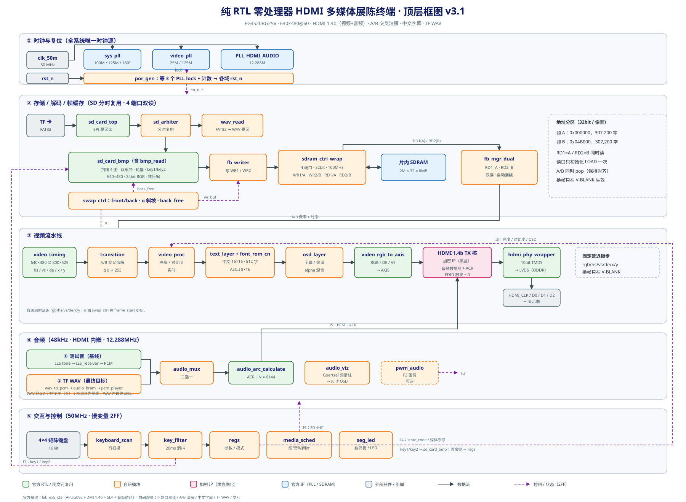

# 总体方案 v3.1（团队唯一基线）

> **状态**：🔒 冻结（2026-10-22）
> **定位**：本文是项目的**唯一真源**。任何与本文冲突的旧文档、聊天记录、口头约定，以本文为准。
> **变更规则**：改接口/改分辨率/改音频通路/改转场方式，必须更新本文 + `接口对接表.md`，并在 `决策记录.md` 留痕。

---

## 1. 一句话说清楚

> 在安路 **EG4S20BG256** 上，用**纯 RTL、零处理器**，做一个"插卡即播"的商业展陈终端：
> TF 卡里的 **640×480 BMP 图片 + 48kHz 音频**，经 FAT32/BMP 解码、SDRAM 双缓冲、中文字幕、A/B 交叉溶解，
> 最终用**一根 HDMI 线同时输出画面和声音**，上电自启、按键/自动轮播。

### 三层定位

| 层 | 内容 |
|:--|:--|
| **赛题层** | 全国大学生嵌入式芯片与系统设计竞赛 · FPGA 创新设计赛道 · 选题一「基于安路 FPGA 的 HDMI 多媒体展示系统」 |
| **产品层** | 智能商业展陈数字标牌：图片轮播 + 音乐 + 中文字幕 + 频谱可视化 |
| **技术层** | 纯 RTL 媒体流水线：存储 → 解码 → 帧缓存 → 合成 → HDMI 1.4b（视频+音频） |

---

## 2. 赛题要求 → 本方案映射

### 2.1 基础要求（必须全部实现）

| 赛题要求 | 本方案 |
|:--|:--|
| ① TF 卡 BMP 读取 + HDMI 显示（640×480、24bit RGB、非压缩） | 官方 `SD/` 全套 + SDRAM 双缓冲 + HDMI 1.4b |
| ② 图片切换 + 自动轮播，画面连续稳定、无明显闪烁 | `sd_card_bmp` + `swap_ctrl` + V-BLANK 换帧 |
| ③ **HDMI 音频输出（48kHz 测试音，音视频同步）** | **HDMI 1.4b TX 核内嵌音频**（数据岛 + ACR） |
| ④ 系统稳定运行、固化、上电即运行 | 单 bitstream + QSPI Flash 固化 + POR |

### 2.2 扩展要求（至少 1 项，目标全做）

| 赛题扩展 | 本方案 | 优先级 |
|:--|:--|:--|
| ① 图层叠加与字幕 | 中文 16×16 字库 + 滚动字幕 + 角标 | ★★★ |
| ② 图片切换与转场 | **A/B 交叉溶解** | ★★★ |
| ③ 图片缩放适配 | **暂不做**（固定 640×480，缩放器预留） | ★☆☆ |
| ④ 实时调节与信息叠加 | 亮度/对比度 + OSD 回显 | ★★☆ |
| ⑤ 音频可视化 | 播放 PCM → Goertzel 频谱柱 → OSD | ★★☆ |

---

## 3. 冻结决策（v3.1）

| # | 决策项 | **结论** | 说明 |
|:--|:--|:--|:--|
| 1 | 开发板 | **同芯片 EG4S20BG256 即可** | PDF 写 HX4S20C；按最新通知"芯片相同即可"，需留通知截图 |
| 2 | 输出分辨率 | **640×480@60（VIC=1）** | HTOTAL=800、VTOTAL=525；像素 25MHz、串行 125MHz |
| 3 | 像素格式 | **RGB888，SDRAM 32bit/像素** | 高 8bit 补 0 |
| 4 | HDMI | **APUG092 HDMI 1.4b TX 核 + 官方 PHY** | 加密核黑盒例化；`I_edid_read_trig=0`（本板无 DDC） |
| 5 | 音频 | **测试音为基线；TF WAV 为最终目标** | 48kHz；N=6144；ACR 动态 CTS |
| 6 | 转场 | **A/B 交叉溶解** | 4 端口 SDRAM：RD1=A、RD2=B，同时读 |
| 7 | 帧缓存 | **`sdram_ctrl_wrap`（4 端口）+ `fb_writer` + `fb_mgr_dual`** | 不再使用官方 `frame_read_write` |
| 8 | 存储/解码 | **官方 `SD/` 全套**（`sd_card_top`/`bmp_read`/`sd_card_bmp`） | 仅小改缓冲索引与换帧握手 |
| 9 | OSD | **中文 16×16 点阵，固定子集 512 字 + ASCII** | 字库放 ERAM；全 GB2312 放不下 |
| 10 | 缩放 | **不做**，固定 640×480 | 输入必须是 640×480；缩放器仅保留文件 |
| 11 | 交互 | 4×4 矩阵键盘 + 数码管 + LED | key1/key2 给 `sd_card_bmp`，其余给 `regs` |
| 12 | 交付 | **单 bitstream + QSPI 固化 + 上电自启** | 不能分次加载基础/扩展 |

---

## 4. 范围边界

| 做（In Scope） | 不做（Out of Scope） |
|:--|:--|
| BMP 图片解码与轮播 | MP4 / H.264 / 视频解码 |
| WAV / PCM 音频播放（最终目标） | MP3 / AAC 解码 |
| A/B 交叉溶解 | 滑动/擦除/3D 转场（可后续扩展） |
| 中文 16×16 字幕 | 全 GB2312 任意中文（字库放不下） |
| 亮度/对比度实时调节 | 饱和度/伽马/边缘检测 |
| Goertzel 频谱柱 | 256/1024 点 FFT（可选冲刺） |
| 640×480 输出 | 720p/1080p 输出 |
| 纯 RTL、零处理器 | 软核、外挂 MCU、树莓派 |

---

## 5. 系统总览



**五条主线**：

1. **时钟/复位**：3 个 PLL + `por_gen`；
2. **存储/解码/帧缓存**：TF → SD → 解码 → 4 端口 SDRAM 双缓冲；
3. **视频流水线**：640×480 时序 → A/B 溶解 → 参数 → 中文字幕 → OSD → AXIS → HDMI；
4. **音频**：测试音 / TF WAV → mux → HDMI 数据岛；
5. **交互**：键盘 → 消抖 → regs / media_sched。

---

## 6. 关键机制

### 6.1 A/B 交叉溶解

- 帧 A、帧 B 分别在 SDRAM 的 `0x000000` / `0x04B000`，各 307,200 字；
- 4 端口控制器：`WR1/RD1 = A`，`WR2/RD2 = B`；
- `fb_mgr_dual` **每帧同时 pop A 和 B**（各 307,200 次），自动回绕，保持指针对齐；
- `transition` 输出：

```
out = (A × (255 - α) + B × α) / 255
```

- `swap_ctrl` 在 `frame_start` 更新 α；α 从 0→255 约 20 帧（≈0.33s）；
- α=255 时翻转 front/back，旧前台变成下一次的后台；
- 转场期间**禁止写新帧**（`back_free=0`）。

### 6.2 中文字幕

- 16×16 点阵，32 字节/字；固定子集 **512 字**（16KB ERAM）+ ASCII 8×16；
- `text_layer` 负责字符定位与滚动偏移，`font_rom_cn` 取模，`osd_layer` 做 alpha 混合；
- 字库 MIF 由 `doc/tools/gen_font_mif.py` 从 TTF 生成（见 `素材与字库规范.md`）。

### 6.3 TF WAV（最终目标）

```
TF → sd_arbiter → wav_read → wav_to_pcm → audio_bram → pcm_player → audio_mux → HDMI 核
```

- `sd_arbiter` 在 `bmp_read` 与 `wav_read` 之间**分时复用** SD 卡；
- 音频优先：先补满 `audio_bram`（建议 0.2s ≈ 38KB），再让图片分块读；
- 48kHz 采样时钟由 12.288MHz 派生（`/256`）；ACR 保证接收端恢复时钟；
- 每张图绑定同名 WAV（`01.bmp ↔ 01.wav`），在换帧点切曲，保证音画同步。

### 6.4 无撕裂

- 换帧只在 **V-BLANK / `frame_start`**；
- 写口在帧起始 `LOAD`，读口只初始化 `LOAD` 一次，靠自动回绕；
- 转场期间只读不写，避免读到半写帧。

---

## 7. 时钟 / 复位

| 时钟 | 频率 | 用途 | 来源 |
|:--|:--|:--|:--|
| `clk_50m` | 50MHz | 控制/键盘/慢速 | 板载 R7 |
| `sd_clk` | 100MHz | SD/FAT32/BMP/WAV | `sys_pll` |
| `mem_clk` | 125MHz | SDRAM/4 端口控制器 | `sys_pll` |
| `mem_clk_180` | 125MHz 180° | SDRAM 相位 | `sys_pll` |
| `pix_clk` | 25MHz | 640×480 像素 | `video_pll` |
| `ser_clk` | 125MHz | TMDS 串行 | `video_pll` |
| `audio_mclk` | 12.288MHz | 48kHz 音频 | `PLL_HDMI_AUDIO` |

- `por_gen`：等 3 个 PLL `lock` + 计数 → 释放各域 `rst_n`；
- 官方模块用高有效 `rst`，自研模块用低有效 `rst_n`，顶层统一取反；
- 跨域单比特用 2FF，多比特用异步 FIFO/握手。

---

## 8. 存储映射

### 8.1 SDRAM（2M × 32bit = 8MB）

| 区域 | 起始字地址 | 长度（字） | 用途 |
|:--|:--|:--|:--|
| 帧 A | `0x000000` | 307,200 | WR1 / RD1 |
| 帧 B | `0x04B000` | 307,200 | WR2 / RD2 |
| 预留 | `0x096000` ~ `0x1FFFFF` | 1,482,752 | 字库/音频/扩展 |

### 8.2 ERAM（约 136KB）

| 用途 | 估算 |
|:--|:--|
| 中文字库 512 字 | 16KB |
| 音频 FIFO（0.2s 立体声 16bit） | 38KB |
| 字库/行缓存/其他 | 余量 |

> 音频 FIFO 最终以综合报告为准；不足时降为 0.15s 或改用 24bit 打包。

---

## 9. 资源预算（初估）

| 模块 | LUT 估算 |
|:--|:--|
| HDMI 1.4b 核（EG4） | 1,734（官方数据） |
| 4 端口 SDRAM + FIFO | 800–1,200 |
| SD/FAT32/BMP | 2,000–3,000 |
| 视频流水线（时序/溶解/参数/OSD） | 1,500–2,500 |
| 中文字库/取模 | 300–600 |
| 音频（测试音/WAV/ACR/频谱） | 1,000–2,000 |
| 控制/键盘/数码管 | 500–1,000 |
| **合计** | **≈ 8K–12K / 19.6K** |

---

## 10. 风险与回退

| 风险 | 概率 | 影响 | 回退 |
|:--|:--|:--|:--|
| HDMI 1.4b 核在本板无 EDID 时不出图/不出声 | 中 | 高 | 先最小工程验证；必要时改回 DVI 核 + PWM（放弃 HDMI 音频，按旧方案） |
| 4 端口双读带宽/对齐 | 低 | 高 | 已在 `hdmi_test` 验证；异常时降为单读 + 黑场淡入淡出 |
| A/B 换帧握手错误 | 中 | 中 | 先做"只读 A"基线，再开 B |
| 中文字库 ERAM 不足 | 低 | 中 | 512→256 字；或压缩为 12×12 |
| WAV + SD 分时导致断音 | 中 | 中 | 增大 FIFO / 预载到 SDRAM |
| 板卡引脚/规则争议 | 中 | 高 | 留通知截图；按 PDF 备 HX4S20C 方案 |
| 固化/单镜像 | 低 | 高 | 提前在 M1 做一次 QSPI 烧录验证 |

---

## 11. 文档索引

| 文档 | 内容 |
|:--|:--|
| `顶层框图.svg` | 系统总图（本方案可视化） |
| `框架说明.md` | 模块层次、时钟复位、数据流、流水线、CDC |
| `接口对接表.md` | I1–I9 接口冻结、时序、SDRAM 端口 |
| `模块清单与分工.md` | 模块归属、状态、保留/删除 |
| `验证与里程碑.md` | M0–M4 验收、测试用例、固化 |
| `素材与字库规范.md` | BMP/WAV/字库/TF 卡/工具 |
| `引脚与硬件.md` | 引脚表、板卡注意事项、PLL |
| `决策记录.md` | 决策变更留痕 |
| `../README.md` | 工程入口与快速开始 |
| `../../项目计划.md` | 项目目标、排期、风险 |

---

## 12. 变更记录

| 版本 | 日期 | 变更 |
|:--|:--|:--|
| v2 | 2026-10-11 | SDRAM 4 端口分配；音频不进 SDRAM |
| v3 | 2026-10-21 | 赛题对齐：640×480 + HDMI 1.4b 音频 + 官方 SD 基线 |
| **v3.1** | **2026-10-22** | **A/B 交叉溶解；中文 512 字库；固定 640×480；TF WAV 最终目标** |
