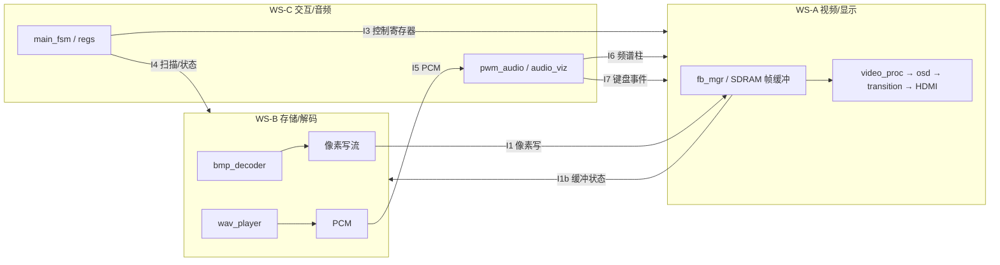
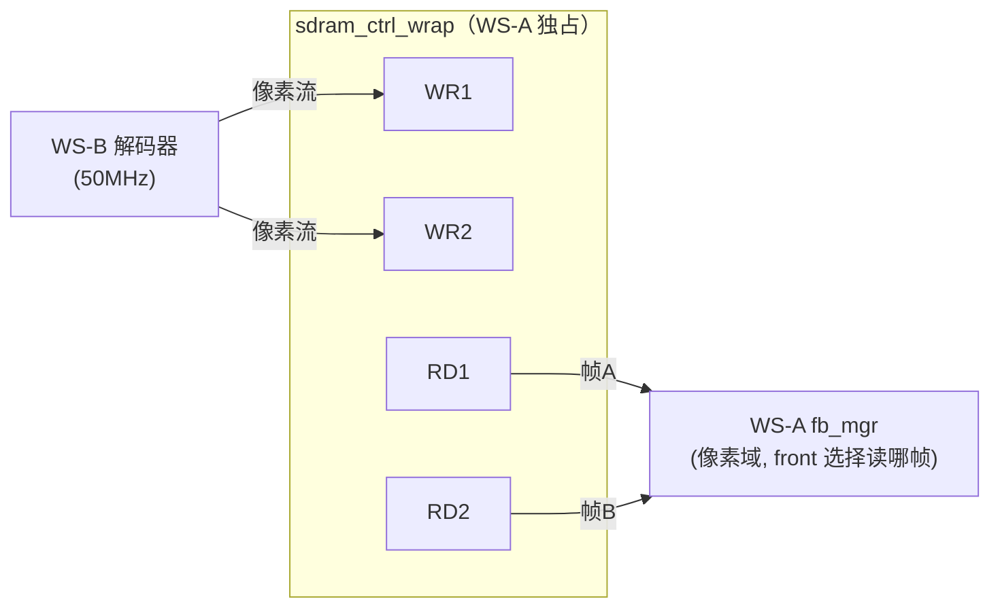

# 接口对接表（三人分工 · 冻结基线 v2）

> 目的：让 WS-A / WS-B / WS-C 三条工作流**并行开发、互不阻塞**。
> 规则：**接口冻结后，改动必须双方确认 + 更新本文档版本号**。
> 状态：🟢 已实现 / 🟡 骨架 / ⚪ 待实现
>
> **v2 变更**：明确 SDRAM 4 端口分配（音频不进 SDRAM，4 口全给图像）；见 §I2。

---

## 1. 分工与模块归属

| 工作流 | 负责内容 | 拥有的模块（文件） |
| :--- | :--- | :--- |
| **WS-A 视频/显示**| 时钟、时序、帧缓冲、缩放、参数、OSD、转场、HDMI 输出 | `clk_gen` `video_timing_720p` `test_pattern` `fb_mgr` `sdram_ctrl_wrap` `bilinear_scaler` `video_proc` `osd_layer` `text_layer` `font_rom` `transition` `hdmi_tx_wrap` |
| **WS-B 存储/解码** | SD 卡、FAT32、媒体扫描、BMP/WAV 解码 | `sd_ctrl` `fat32_reader` `media_scan` `bmp_decoder` `wav_player` |
| **WS-C 交互/音频** | 键盘、控制寄存器、主控 FSM、数码管/LED、音频播放与可视化 | `keyboard_scan` `key_filter` `regs` `main_fsm` `seg_led` `pwm_audio` `audio_viz` `mic_adc` |

### 接口总览

---

## 2. 接口清单

| 编号 | 接口 | 方向 | 责任人 | 状态 |
| :--- | :--- | :--- | :--- | :--- |
| **I1** | 像素写入帧缓冲 | WS-B → WS-A | 双方 | 🟡 |
| **I1b** | 帧缓冲状态/反压 | WS-A → WS-B | WS-A | 🟡 |
| **I2** | SDRAM 控制器归属 + **4 端口分配** | — | WS-A | 🟢 |
| **I3** | 控制寄存器（参数） | WS-C → WS-A | WS-C | 🟢 |
| **I3b** | 转场控制 | WS-C → WS-A | 双方 | 🟢 |
| **I4** | 扫描启动/媒体状态 | 双向 WS-C↔WS-B | 双方 | 🟡 |
| **I5** | 音频 PCM | WS-B → WS-C | 双方 | 🟡 |
| **I6** | 频谱柱 | WS-C → WS-A | WS-C | 🟡 |
| **I7** | 键盘事件 | WS-C → WS-A | WS-C | 🟢 |
| **I8** | 时钟/复位 | — | WS-A | 🟢 |

---

## 3. 接口信号详解

### I1 · 像素写入帧缓冲（WS-B → WS-A）★最核心

> 约定在**像素流层面**对接：WS-B 只给"坐标 + 颜色"，**地址计算和 SDRAM 读写由 WS-A 负责**。

| 信号 | 位宽 | 方向 | 含义 |
| :--- | :--- | :--- | :--- |
| `dec_we` | 1 | B→A | 像素写使能（高有效，单拍） |
| `dec_x` | 11 | B→A | 目标像素列（0..1279） |
| `dec_y` | 11 | B→A | 目标像素行（0..719） |
| `dec_pix` | 16 | B→A | RGB565 像素 |
| `frame_done` | 1 | B→A | 一帧全部写完（单拍，触发缓冲翻转） |
| `img_w` | 16 | B→A | 源图宽（缩放系数用） |
| `img_h` | 16 | B→A | 源图高 |
| `header_ok` | 1 | B→A | 头部解析完成，后续 `dec_*` 有效 |

**时序约定**：
- `dec_we=1` 时，`dec_x/dec_y/dec_pix` 必须同时有效，**每个像素一拍**；
- 像素须按**光栅顺序**（y 增、每行 x 增）输出，与线性地址递增一致；
- 一帧完成后拉高 `frame_done` 一拍；
- WS-B **必须**先查 I1b 的 `back_free` 再开始写，避免覆盖正在显示的前台帧；
- WS-A 内部把该像素流**路由到"后台那块缓冲"对应的写口**（WR1 或 WR2），WS-B 无需知道是哪一块。

### I1b · 帧缓冲状态/反压（WS-A → WS-B）

| 信号 | 位宽 | 方向 | 含义 |
| :--- | :--- | :--- | :--- |
| `buf_ready` | 1 | A→B | 前台缓冲有内容可显示 |
| `back_free` | 1 | A→B | 后台缓冲空闲，可以写下一帧 |
| `swap_done` | 1 | A→B | 本帧翻转完成（单拍） |

> 简单模式：只要 `back_free=1` 就可以写；写完 `frame_done`，WS-A 在 `frame_start` 翻转。

### I2 · SDRAM 控制器归属与 4 端口分配（WS-A 独占，冻结）★

**归属**：`sdram_ctrl_wrap`（含片内 SDRAM、`Sdram_Control_4Port`、`sdram_pll`）由 **WS-A 独占**。
WS-B / WS-C **不得直接例化 SDRAM**，只能通过 WS-A 提供的端口访问。

**端口分配（2 写 + 2 读，全部给图像）**：

| 端口 | 绑定 | 谁驱动 | 时钟域 | 方向 |
| :--- | :--- | :--- | :--- | :--- |
| `WR1` | 帧缓冲 A（写） | WS-B 解码器 | `clk_50m` | 写 |
| `RD1` | 帧缓冲 A（读） | WS-A `fb_mgr` | `clk_pix` | 读 |
| `WR2` | 帧缓冲 B（写） | WS-B 解码器 | `clk_50m` | 写 |
| `RD2` | 帧缓冲 B（读） | WS-A `fb_mgr` | `clk_pix` | 读 |

**双缓冲映射**：
- **一口绑一块缓冲**：每块缓冲独占「一个写口 + 一个读口」，翻帧时**不改地址寄存器**。
- **前台/后台**：`fb_mgr.front` 决定"显示 RD1 还是 RD2"、"解码器写 WR1 还是 WR2"。
- **翻转点**：**只在 `frame_start`**（红线③）。

**音频不进 SDRAM**：音频数据量极小（48 kHz × 16bit ≈ 96 KB/s），由 WS-C 自带的 **BRAM 环形 FIFO** 缓冲；因此 SDRAM 的 **4 个口全部留给图像**（2 写做双缓冲、2 读支持转场）。

**时钟域说明**：SDRAM 边界天然跨域——写口用 `clk_50m`、读口用 `clk_pix`，控制器本身有 `WRx_CLK`/`RDx_CLK`，**不需要额外的 CDC 逻辑**。

**地址分区（WS-A 实现，WS-B/C 无需关心）**：

| 区域 | 起始字地址 | 长度（字） | 用途 |
| :--- | :--- | :--- | :--- |
| 帧缓冲 A | `0x000000` | 921,600 | WR1 / RD1 |
| 帧缓冲 B | `0x0E1000` | 921,600 | WR2 / RD2 |
| 预留（音频/索引/扩展） | `0x1C2000` | 253,952 | 暂空 |

> 注：`DSIZE=16`（1 字 = 16bit = 1 个 RGB565 像素）。**地址由控制器自动顺序递增**，WS-A 只需配置起始/结束/突发长度并产生 `LOAD`——**不需要逐像素算地址**。

**每个端口的配置参数**：

| 参数 | 含义 |
| :--- | :--- |
| `xxx_ADDR` | 起始地址 |
| `xxx_MAX_ADDR` | 结束地址（到顶回绕） |
| `xxx_LENGTH` | 突发长度（如 256） |
| `xxx_LOAD` | 脉冲一次：地址指针复位 + 清 FIFO |
| `WRx_FULL` / `RDx_EMPTY` | 反压信号（写满 / 读空） |

### I3 · 控制寄存器（WS-C → WS-A）

| 地址 | 字段 | 位宽 | 谁写 | 谁读 | 含义 |
| :--- | :--- | :--- | :--- | :--- | :--- |
| 0x00 | `brightness` | 8 | C | A `video_proc` | 亮度偏移（signed） |
| 0x01 | `contrast` | 8 | C | A | 对比度，128=1.0 |
| 0x02 | `saturation` | 8 | C | A | 饱和度，128=1.0 |
| 0x03 | `transition_type` | 2 | C | A `transition` | 转场类型 |
| 0x05 | `media_index` | 8 | C | A / 数码管 | 当前媒体序号 |
| 0x07 | `osd_en` / `auto_play` | 1/1 | C | A `osd_layer` | 字幕使能 / 自动轮播 |

### I3b · 转场控制（WS-C → WS-A）

| 信号 | 位宽 | 方向 | 含义 |
| :--- | :--- | :--- | :--- |
| `transition_mode` | 2 | C→A | 0 溶解 / 1 滑动 / 2 擦除 / 3 垂直 |
| `blend` | 8 | C→A | 0→A 帧，255→B 帧 |
| `transition_active` | 1 | C→A | 转场进行中 |
| `swap_req` | 1 | C→A | 请求帧末翻转 |

> ⚠️ 红线：`transition_mode` / `swap_req` 的更新**只在 `frame_start` 生效**（由 WS-A `fb_mgr` 保证）。

### I4 · 扫描启动 / 媒体状态（WS-C ↔ WS-B）

| 信号 | 位宽 | 方向 | 含义 |
| :--- | :--- | :--- | :--- |
| `scan_start` | 1 | C→B | 启动根目录扫描（单拍） |
| `scan_done` | 1 | B→C | 扫描完成（单拍） |
| `sd_init_done` | 1 | B→C | SD 初始化完成 |
| `media_count` | 8 | B→C | 有效媒体数量（数码管显示） |

### I5 · 音频 PCM（WS-B → WS-C）—— 不走 SDRAM

| 信号 | 位宽 | 方向 | 含义 |
| :--- | :--- | :--- | :--- |
| `pcm_l` / `pcm_r` | 16/16 | B→C | 有符号 PCM |
| `pcm_valid` | 1 | B→C | 48kHz 采样节拍 |
| `eof` | 1 | B→C | 文件结束 |

> - **接口边界 = "PCM 流"本身**：WS-B 只负责"产出 PCM 流"，WS-C 自带 **BRAM 环形 FIFO** 缓冲后播放；
> - **缓冲属于 WS-C**，WS-B 不碰音频缓冲的内存；
> - 同时钟域 → 普通同步 FIFO；异域 → `async_fifo`（由 B/C 确认）；
> - **音频不占用任何 SDRAM 端口**（见 §I2）。
>
> 采样节拍与画面同源（由 WS-A 的时钟派生），保证音画同步。

### I6 · 频谱柱（WS-C → WS-A）

| 信号 | 位宽 | 方向 | 含义 |
| :--- | :--- | :--- | :--- |
| `bars` | BARS×8 | C→A | 每根柱高度（0..255） |
| `bars_valid` | 1 | C→A | 刷新脉冲 |

### I7 · 键盘事件（WS-C → WS-A）

| 信号 | 位宽 | 方向 | 含义 |
| :--- | :--- | :--- | :--- |
| `ev_next` / `ev_prev` | 1 | C→A | 下一张 / 上一张 |
| `ev_mode` | 1 | C→A | 切换转场类型 |
| `ev_auto` | 1 | C→A | 自动轮播开关 |

### I8 · 时钟 / 复位

| 信号 | 来源 | 使用者 |
| :--- | :--- | :--- |
| `clk_50m` | 板载 R7 | WS-B、WS-C、慢速逻辑 |
| `clk_pix` / `clk_pix5x` | WS-A `clk_gen` | WS-A 视频链 |
| `rst_n`（50M 域） | WS-A `reset_sync` | WS-B、WS-C |
| `rst_pix_n`（像素域） | WS-A `reset_sync` | WS-A 视频链 |
| 跨域 | 多比特用 `async_fifo`，单比特用 `cdc_sync` | 全体 |

---

## 6. 联调里程碑

| 阶段 | 内容 | 参与 | 验收 |
| :--- | :--- | :--- | :--- |
| **J1** | WS-A 自测：假数据源 → SDRAM 帧缓冲 → 显示 | A | 屏上出现"来自内存"的图 |
| **J2** | WS-B 自测：SD → FAT32 → BMP 解码 → 输出像素流（可仿真） | B | 仿真波形正确 |
| **J3** | A+B 对接 I1：真实 BMP 上屏（先 1280×720 免缩放） | A、B | 显示 SD 卡图片 |
| **J4** | + 控制 I3/I7：键盘切图、调亮度 | A、C | 交互有效 |
| **J5** | + 音频 I5/I6：音乐 + 频谱 + 音画同步 | A、B、C | 完整演示 |
| **J6** | + 缩放/转场/字幕，长跑烤机 | 全体 | 全 5 项达标 |

---

## 7. 变更记录

| 版本 | 日期 | 变更 | 提出人 | 确认 |
| :--- | :--- | :--- | :--- | :--- |
| v1 | 2026-10-10 | 首次冻结接口 | — | — |
| v2 | 2026-10-11 | **明确 SDRAM 4 端口分配**：音频不进 SDRAM、4 口全给图像（2 写=A/B 帧、2 读=A/B 帧）；补充时钟域说明与地址分区；I5 明确"PCM 流为边界、缓冲归 WS-C"；I1 增加"光栅顺序 + WS-A 路由到后台写口" | WS-A | 待 WS-B / WS-C 确认 |

