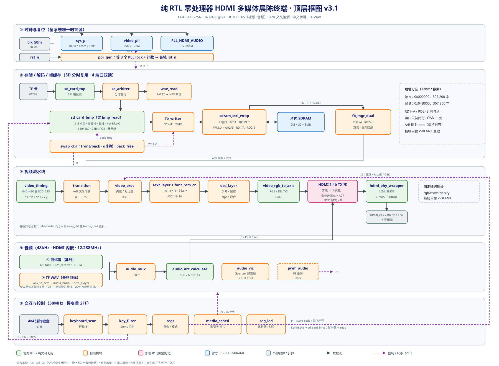

# 框架说明 v3.1（模块层次 · 时钟复位 · 数据流 · 流水线 · CDC）

> 上位文档：`总体方案_v3.1.md`（唯一真源）
> 本文回答："系统由哪些模块组成、它们怎么连、时钟怎么走、数据怎么流"。

---

## 1. 顶层框图



---

## 2. 模块层次树

```
top.v
├── 时钟/复位
│   ├── sys_pll              (100M / 125M / 125M_180)
│   ├── video_pll            (25M / 125M)
│   ├── PLL_HDMI_AUDIO       (12.288M)
│   └── por_gen              (3 lock + 计数 → 各域 rst_n)
│
├── 存储 / 解码
│   ├── sd_card_top          (SPI 物理层)
│   ├── sd_arbiter           (bmp_read / wav_read 分时)
│   ├── sd_card_bmp          (扫描 4 图 / 双缓冲 / 轮播)
│   │   └── bmp_read         (FAT32 + BMP 解析)
│   ├── wav_read             (FAT32 → WAV 扇区流)
│   └── media_sched          (图/音时间片调度)
│
├── 帧缓存
│   ├── fb_writer            (像素流 → WR1/WR2)
│   ├── sdram_ctrl_wrap      (Sdram_Control_4Port, 32bit)
│   │   └── EG_PHY_SDRAM_2M_32 (片内 8MB)
│   ├── fb_mgr_dual          (RD1=A / RD2=B 双读)
│   └── swap_ctrl            (front/back · α 斜坡 · back_free)
│
├── 视频
│   ├── video_timing_640x480 (hs/vs/de/x/y/frame_start)
│   ├── transition           (A/B 交叉溶解)
│   ├── video_proc           (亮度/对比度)
│   ├── text_layer           (中文/ASCII 字幕定位)
│   ├── font_rom_cn          (16×16 点阵, 512 字)
│   ├── osd_layer            (alpha 混合)
│   └── video_rgb_to_axis    (RGB/DE/VS → AXIS)
│
├── HDMI
│   ├── hdmi_1_4b_transmitter_core_wrapper (加密, 黑盒)
│   └── hdmi_phy_wrapper     (10bit TMDS → LVDS, ODDR)
│
├── 音频
│   ├── hdmi_audio_tone_i2s  (内部音阶测试音)
│   ├── I2S_receiver         (I2S → 24bit PCM)
│   ├── wav_to_pcm           (WAV 头解析 → PCM)
│   ├── audio_bram           (PCM 环形 FIFO)
│   ├── pcm_player           (48kHz 读出)
│   ├── audio_mux            (测试音 / WAV)
│   ├── audio_arc_calculate  (ACR: N=6144)
│   ├── audio_viz            (Goertzel 频谱柱)
│   └── pwm_audio            (F3 备份, 可选)
│
└── 控制
    ├── keyboard_scan        (4×4 行扫描)
    ├── key_filter           (20ms 消抖)
    ├── regs                 (亮度/对比度/OSD/转场)
    └── seg_led              (4 位数码管 + 8 LED)
```

---

## 3. 时钟与复位

### 3.1 时钟树

| 时钟 | 频率 | 域 | 使用者 |
|:--|:--|:--|:--|
| `clk_50m` | 50MHz | 控制 | `keyboard_scan`/`key_filter`/`regs`/`seg_led` |
| `sd_clk` | 100MHz | SD | `sd_card_top`/`sd_arbiter`/`bmp_read`/`wav_read`/`sd_card_bmp` |
| `mem_clk` | 125MHz | SDRAM | `sdram_ctrl_wrap`/`fb_writer`/`fb_mgr_dual`（写侧） |
| `mem_clk_180` | 125MHz 180° | SDRAM | `sdram_ctrl_wrap` 相位 |
| `pix_clk` | 25MHz | 像素 | `video_timing`/`fb_mgr_dual`（读侧）/`transition`/`video_proc`/OSD/`video_rgb_to_axis`/HDMI 核 |
| `ser_clk` | 125MHz | 串行 | `hdmi_phy_wrapper` |
| `audio_mclk` | 12.288MHz | 音频 | `hdmi_audio_tone_i2s` |

**PLL 参数（以官方 `sys_pll`/`video_pll`/`PLL_HDMI_AUDIO` 为准）**：

```
50MHz ── sys_pll ──────> 100MHz (sd) + 125MHz (mem) + 125MHz_180
      ── video_pll ────> 25MHz (pix) + 125MHz (ser)
      ── PLL_HDMI_AUDIO > 12.288MHz (audio)
```

### 3.2 复位

- `por_gen` 输入：`rst_n` + 3 个 `lock`；
- 逻辑：所有 PLL 锁定后，再等 `2^16` 个 `clk_50m` 周期，释放 `por_done`；
- 各域复位：`por_done` 同步到目标时钟域，得到 `rst_n_sd`/`rst_n_mem`/`rst_n_pix`/`rst_n_aud`；
- 官方模块用**高有效** `rst`：`assign rst_xxx = ~rst_n_xxx`；
- 自研模块统一用**低有效** `rst_n`。

> 上电顺序很重要：SD 卡初始化、SDRAM 初始化都必须在 PLL 稳定之后；否则会花屏/读卡失败。

---

## 4. 数据流

### 4.1 图像通路

```
TF 卡
  │ SPI (CS/CLK/MOSI/MISO)
  ▼
sd_card_top ── 扇区读写 ──> sd_arbiter ──> bmp_read
                                            │ 像素流 (24bit, 光栅顺序)
                                            ▼
                                      sd_card_bmp
                                      (扫描/轮播/双缓冲索引)
                                            │ write_en + write_data[31:0]
                                            ▼
                                       fb_writer
                                       (WR1/WR2, 帧首 LOAD)
                                            ▼
                                  sdram_ctrl_wrap (4 端口)
                                            │
                              ┌─────────────┴─────────────┐
                              ▼                           ▼
                         RD1 (帧 A)                  RD2 (帧 B)
                              └─────────────┬─────────────┘
                                            ▼
                                      fb_mgr_dual
                                      (A/B 同时 pop)
                                            │ a_rgb / b_rgb + de/hs/vs/x/y
                                            ▼
                                       transition
                                       (α 混合)
                                            ▼
                                       video_proc
                                            ▼
                                  text_layer → osd_layer
                                            ▼
                                   video_rgb_to_axis
                                            ▼
                                  HDMI 1.4b TX 核 → PHY → 显示器
```

**关键点**：

- `bmp_read`/`sd_card_bmp` 输出的是**源图像素流**（640×480，24bit）；
- `fb_writer` 打包成 32bit（`{R,G,B,8'h0}`）写入；
- `fb_mgr_dual` 每帧各 pop 307,200 次，A/B 指针自动回绕；
- 解码/写入是 100MHz 域，显示读出是 25MHz 域，SDRAM 控制器内部跨域。

### 4.2 音频通路

```
① 测试音（基线）
   12.288MHz → hdmi_audio_tone_i2s → I2S_receiver → PCM (24bit L/R)
                                                        │
② TF WAV（最终目标）                                    │
   TF → sd_arbiter → wav_read → wav_to_pcm              │
        → audio_bram → pcm_player → PCM (24bit L/R)     │
                                                        ▼
                                                   audio_mux
                                                        │
                        audio_arc_calculate (ACR) ──────┤
                                                        ▼
                                              HDMI 1.4b TX 核
                                              (音频数据岛 + ACR)
```

- 测试音：内部音阶（do/re/mi…），满足基础要求③；
- WAV：48kHz、16bit、立体声、PCM；每张图绑定同名 WAV；
- `audio_bram`：0.2s ≈ 38KB，跨 `sd_clk`/`pix_clk` 双时钟；
- `pcm_player`：按 48kHz 节拍输出 `audio_valid`；
- `audio_mux`：`regs.audio_src` 选择测试音/WAV；
- `pwm_audio`：可选备份，走 F3。

### 4.3 控制/状态通路

```
4×4 键盘 → keyboard_scan → key_filter
                              ├── key1/key2（电平） → sd_card_bmp（自带 20ms 消抖）
                              └── 其余键（脉冲）   → regs
                                                     ├── video_proc（亮度/对比度）
                                                     ├── osd_layer（OSD 使能）
                                                     ├── transition（转场开关）
                                                     └── media_sched（曲目/模式）

sd_card_bmp.state_code / disp_idx ──> seg_led / led
swap_ctrl.front ─────────────────────> seg_led / led
audio_bram.level ────────────────────> media_sched（补数据）
```

- 控制域 50MHz；参数是慢变量，2FF 同步到 25MHz/100MHz；
- 按键跨域：`key_filter` 输出稳定电平，`sd_card_bmp` 内部再消抖；
- 状态显示：数码管显示 `state_code` + 媒体序号，LED 显示 PLL/SD/帧/转场状态。

---

## 5. 视频流水线

### 5.1 级联与延迟

| 级 | 模块 | 作用 | 延迟（pix_clk） |
|:--|:--|:--|:--|
| 0 | `video_timing_640x480` | hs/vs/de/x/y/frame_start | 0 |
| 1 | `fb_mgr_dual` | 双读 A/B（FIFO 预取） | 0–1 |
| 2 | `transition` | A/B 加权 | 1 |
| 3 | `video_proc` | 亮度/对比度 | 2 |
| 4 | `text_layer` + `font_rom_cn` | 字幕/角标取模 | 1（ROM） |
| 5 | `osd_layer` | alpha 混合 | 1 |
| 6 | `video_rgb_to_axis` | AXIS 打包 | 1 |

**锁步约定**：每一级必须同时延迟 `rgb / hs / vs / de / x / y`。
建议统一用一个 `vpipe_delay` 小模块，避免"颜色对齐、坐标没对齐"。

### 5.2 AXIS 约束（HDMI 核要求）

- 一行数据必须**连续**，`O_axis_s_ready` 只在 `last` 后拉低；
- `I_axis_s_user` 在每帧第一行第一个有效像素拉高一拍；
- `I_axis_s_last` 在每行最后一个像素拉高一拍；
- 外部时序必须与核参数一致：`HACTIVE/HTOTAL/VACTIVE/VTOTAL`；
- 本设计：640/800/480/525，VIC=1，RGB888。

### 5.3 时序参数

| 参数 | 值 |
|:--|:--|
| HTOTAL | 800 |
| HSA / HFP / HBP | 96 / 16 / 48 |
| HACTIVE | 640 |
| VTOTAL | 525 |
| VSA / VFP / VBP | 2 / 10 / 33 |
| VACTIVE | 480 |
| 像素时钟 | 25MHz |
| 帧率 | ≈59.5Hz（25MHz / (800×525)） |

---

## 6. 帧缓存与 A/B 机制

### 6.1 4 端口分配

| 端口 | 绑定 | 驱动 | 时钟 |
|:--|:--|:--|:--|
| `WR1` | 帧 A 写 | `fb_writer` | `sd_clk`（100M） |
| `RD1` | 帧 A 读 | `fb_mgr_dual` | `pix_clk`（25M） |
| `WR2` | 帧 B 写 | `fb_writer` | `sd_clk`（100M） |
| `RD2` | 帧 B 读 | `fb_mgr_dual` | `pix_clk`（25M） |

### 6.2 指针规则（已验证）

- **读口只初始化 LOAD 一次**（`RD_LD_FRM=0`），之后靠 `MAX_ADDR` 自动回绕；
- **写口每次帧首 LOAD**，把写指针复位到基地址；
- 读口每帧 pop 307,200 次（A/B 各一份），保证帧边界对齐；
- 不要在每帧给读口 LOAD（会推偏指针，实测半屏偏移）。

### 6.3 swap_ctrl 状态

```
IDLE ──(sd_card_bmp.frame_ready)──> FADE_OUT? (α 0→255)
                                        │
                                        ▼
                                   SWAP (α=255, frame_start)
                                        │
                                        ▼
                                   FADE_IN? (下一张)
```

- `front`/`back` 由 `swap_ctrl` 维护；
- `back_free = (state == IDLE)`；
- `sd_card_bmp` 只能写 `back`；转场期间禁止写；
- `α` 每帧更新一次（`frame_start`），避免帧内突变。

### 6.4 带宽

- 显示：2 × 307,200 × 60 ≈ **36.9 Mword/s**（A+B 同时读）；
- 写入：一张图 307,200 字，按需突发；
- SDRAM 100MHz × 32bit = 400MB/s，余量充足。

---

## 7. 音频与 SD 分时

### 7.1 SD 仲裁

- `sd_arbiter` 两个客户：`bmp_read`（高突发）、`wav_read`（低带宽持续）；
- 策略：**音频优先补 FIFO**，FIFO 达到高水位后让出给图片；
- 时间片建议：音频 20ms / 图片 20ms 交替；
- 音频 FIFO 低水位告警时，暂停图片写。

### 7.2 ACR

- `N = 6144`；
- `CTS` 由 `audio_arc_calculate` 按像素时钟动态计算；
- 接收端用 ACR 从 TMDS 时钟恢复 48kHz 音频时钟。

### 7.3 音画同步

- 换图时，`media_sched` 在 `frame_start` 同时切换 WAV 文件；
- 若单曲 BGM 循环，则不需要切曲，只保证采样率稳定；
- 最终以"每图绑定同名 WAV"为准。

---

## 8. 跨时钟域（CDC）清单

| 信号 | 从 → 到 | 方式 |
|:--|:--|:--|
| `write_finish_toggle` | `mem_clk` → `sd_clk` | 2FF/toggle |
| `disp_buf_idx` / `back_free` | `pix_clk` → `sd_clk` | 2FF（慢变量） |
| `regs` 参数 | `clk_50m` → `pix_clk` | 2FF |
| `key` 电平 | `clk_50m` → `sd_clk` | 2FF |
| `state_code` | `sd_clk` → `clk_50m` | 2FF |
| `audio` PCM | `sd_clk` → `pix_clk` | 双时钟 BRAM |
| `bars` | `pix_clk` 内 | 同域 |
| `sd_arbiter` 授权 | `sd_clk` 内 | 同域 |

> 多比特数据（像素、PCM）必须走 FIFO/BRAM，不能逐位 2FF。

---

## 9. 关键约束（红线）

1. **换帧只在 V-BLANK / `frame_start`**；
2. **读口只初始化 LOAD 一次**，写口帧首 LOAD；
3. **AXIS 行数据连续**，不能断流；
4. **转场期间禁止写新帧**；
5. **加密 IP 只黑盒例化**，不改 `.enc.v`；
6. **单 bitstream** 覆盖基础+扩展；
7. **上电自启**，不依赖 PC；
8. **零处理器**，不用 M0/外挂 MCU。

---

## 10. 存储分配

### SDRAM

| 区域 | 起始 | 长度 | 用途 |
|:--|:--|:--|:--|
| 帧 A | `0x000000` | 307,200 | WR1/RD1 |
| 帧 B | `0x04B000` | 307,200 | WR2/RD2 |
| 预留 | `0x096000`~ | 1,482,752 | 字库/音频/扩展 |

### ERAM

| 用途 | 估算 |
|:--|:--|
| 中文字库 512 字 | 16KB |
| 音频 FIFO 0.2s | 38KB |
| 其他（行缓存/系数/状态） | 余量 |

---

## 11. 资源估算

| 模块 | LUT |
|:--|:--|
| HDMI 1.4b 核 | 1,734 |
| SDRAM 4 端口 + FIFO | 800–1,200 |
| SD/FAT32/BMP | 2,000–3,000 |
| 视频流水线 | 1,500–2,500 |
| 字库/OSD | 300–600 |
| 音频 | 1,000–2,000 |
| 控制 | 500–1,000 |
| **合计** | **≈ 8K–12K / 19.6K** |
