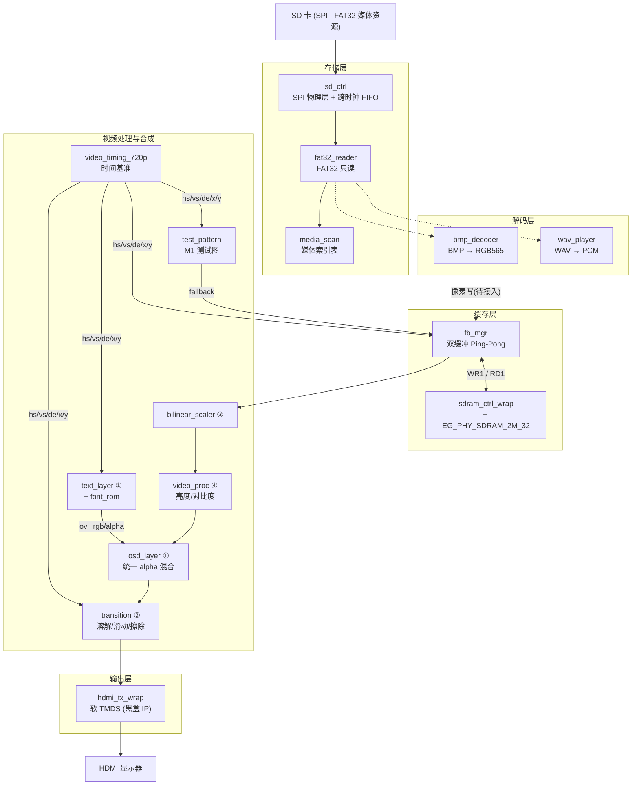
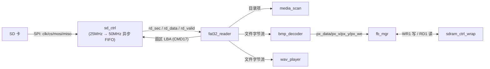
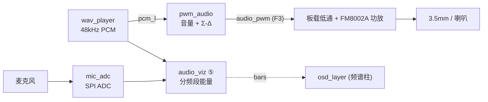
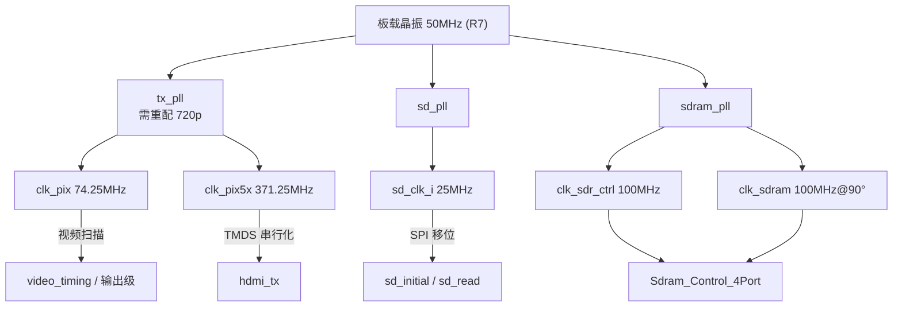
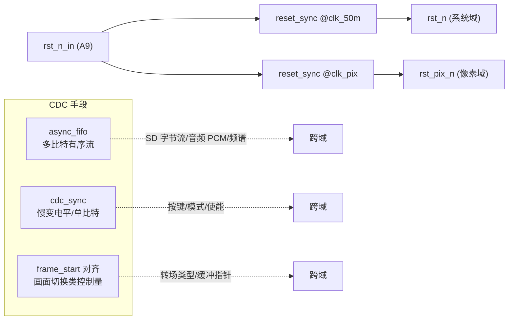
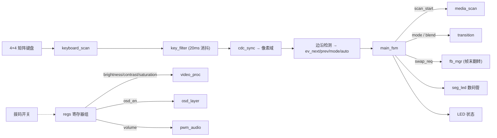
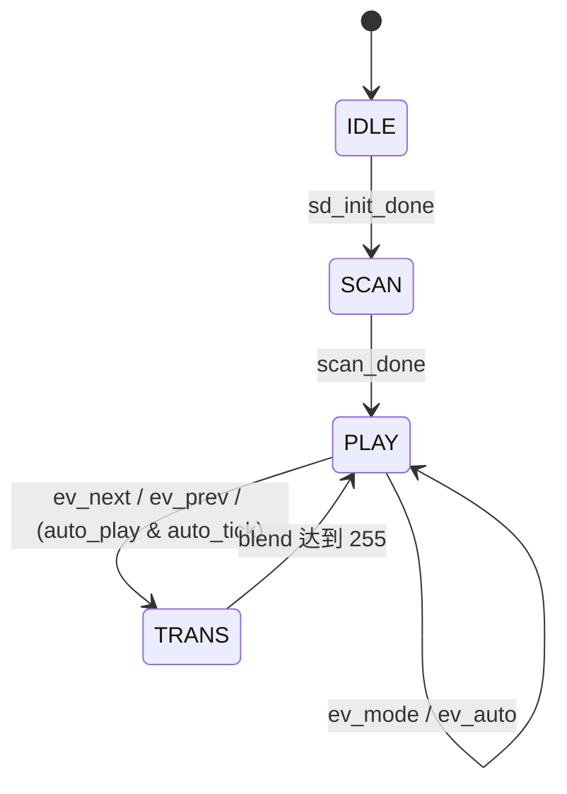
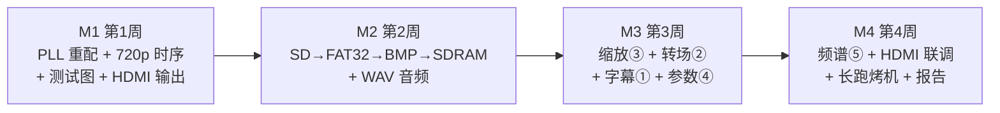

# 框架说明（模块清单 · 时钟复位 · CDC · 存储映射 · 集成说明）

本文档面向团队成员，说明 `project/` 工程框架的**接口约定、状态与集成顺序**。
上位规划见 `../项目计划.md`，逐文件接口细节见 `../README.md`。

> 图形采用 **Mermaid**（VS Code / GitHub / Typora 的 Markdown 预览可直接渲染）。
> 约定：**实线 `-->`** = 顶层已实际连接；**虚线 `-.->`** = 规划中/待接入（骨架 TODO）。

---

## 1. 系统数据流

### 1.1 顶层总览



> 说明：当前 `fb_mgr.buf_ready = 0`，扫描输出取 `fallback = test_pattern`（M1 彩条）；
> `transition` 的 A/B 暂接同一像素流，待 SDRAM 双帧接入后生效。

### 1.2 存储 → 解码 → 帧缓冲（第 2 周打通）



### 1.3 音频通路



---

## 2. 时钟 / 复位 / CDC

### 2.1 时钟树



### 2.2 时钟域划分

| 时钟域 | 频率 | 用途 | 来源 |
| :--- | :--- | :--- | :--- |
| `clk_50m` | 50 MHz | 控制 FSM、SD、FAT32、音频 | R7 |
| `clk_pix` | 74.25 MHz（目标） | 720p 扫描（HDMI） | tx_pll C1 |
| `clk_pix5x` | 371.25 MHz（目标） | TMDS 串行化 | tx_pll C2 |
| `sd_clk_i` | 25 MHz | SD SPI 移位 | sd_pll |
| `clk_sdr_ctrl` / `clk_sdram` | 100 MHz / 100 MHz@90° | SDRAM 控制器 | sdram_pll |

### 2.3 复位与跨时钟域（CDC）



- **复位**：低有效，异步拉低、同步释放；分别对齐到 `clk_50m` 与 `clk_pix`。
- **CDC 三原则**：
  1. 多比特数据流 → `async_fifo`（格雷码指针 + 两级同步）；
  2. 单比特慢变量 → `cdc_sync`；
  3. **会改变画面的控制量**（转场类型、缓冲指针）只在 `frame_start` 生效（红线③）。

---

## 3. 控制通路



### 3.1 主控状态机



---

## 4. 模块清单与状态

> ✅=可综合实现　🟡=接口骨架（TODO 待填）。逐文件接口见 `../README.md §4`。

### 4.1 公共 `rtl/common/`
| 模块 | 接口要点 | 状态 |
| :--- | :--- | :--- |
| `reset_sync` | `clk, arst_n -> rst_n` | ✅ |
| `cdc_sync` | `clk_dst, d_async[W] -> q_sync[W]` | ✅ |
| `async_fifo` | 双时钟，`DW/DEPTH` 参数，`full/empty` | ✅ |
| `clk_gen` | 例化 `tx_pll` → `clk_pix/clk_pix5x/clk_25m` | ✅（依赖重配PLL） |

### 4.2 视频 `rtl/video/`
| 模块 | 接口要点 | 状态 |
| :--- | :--- | :--- |
| `video_timing_720p` | `clk_pix -> hs,vs,de,x,y,frame_start,line_start` | ✅ |
| `test_pattern` | `(de,x,y) -> rgb565` | ✅ |
| `hdmi_tx_wrap` | `(clk_pix,clk_pix5x,de,rgb565) -> 4×差分对` | ✅ |
| `video_proc` | `rgb565 + brightness/contrast/saturation -> rgb565` | ✅（饱和度TODO） |
| `transition` | `a,b,hs/vs/de,x,y,mode,blend -> rgb565` | ✅ |
| `bilinear_scaler` | 目标域 `(x_out,y_out)` + 源尺寸 → `rd_x0/y0` + 2×2邻域 → `dst_pix` | 🟡 |

### 4.3 合成 `rtl/compose/`
| 模块 | 接口要点 | 状态 |
| :--- | :--- | :--- |
| `fb_mgr` | 扫描输出 + SDRAM 读口 + 解码写口 + `swap_req/done` | 🟡 |
| `osd_layer` | `base + (ovl_rgb,ovl_alpha,ovl_valid) -> rgb` | ✅ |
| `text_layer` | 取模地址 `fnt_addr` + 文本RAM → `ovl_*` | 🟡 |
| `font_rom` | 封装 `ascii_3216`，`addr[12:0] -> data[7:0]` | 🟡 |

### 4.4 存储 / 解码 / 音频 / 控制
| 模块 | 接口要点 | 状态 |
| :--- | :--- | :--- |
| `storage/sd_ctrl` | SPI 物理口 + `rd_sec/rd_req/rd_data/rd_valid/rd_pop/rd_done/init_done` | ✅ |
| `storage/fat32_reader` | 连 `sd_ctrl` + 文件字节流输出 | 🟡 |
| `storage/media_scan` | 目录流 → 媒体索引表 | 🟡 |
| `storage/sdram_ctrl_wrap` | 4 端口 FIFO 接口 + 时钟生成 | ✅ |
| `decode/bmp_decoder` | 文件流 → `px_data/x/y/we` + `img_w/h` | 🟡 |
| `decode/wav_player` | 文件流 → `pcm_l/r/pcm_valid` | 🟡 |
| `audio/pwm_audio` | `pcm + volume -> audio_pwm` | ✅ |
| `audio/audio_viz` | `pcm/mic -> bars[BARS*8]` | 🟡 |
| `audio/mic_adc` | SPI ADC 物理口 → `sample` | ✅ |
| `control/main_fsm` | 状态机：自检→扫描→轮播→转场 | ✅ |
| `control/regs` | 寄存器映射（亮度/对比度/音量/序号/模式…） | ✅ |
| `control/seg_led` | `value[31:0] -> seg_sel/seg_led` | ✅ |

---

## 5. 存储映射（SDRAM 2M×32）

`sdram_ctrl_wrap` 的 `DSIZE=16`，地址 `ASIZE=21`，组成 `{bank[1:0], row[10:0], col[8:0]}`。

```text
word 地址      0x000000        0x0E1000        0x1C2000      0x1E2000        0x200000
               ├───────────────┼───────────────┼─────────────┼───────────────┤
区域            │  帧缓冲 A      │  帧缓冲 B      │ 音频环形缓冲 │ 媒体索引/暂存  │
容量(16bit)     │  921,600       │  921,600       │ 131,072      │ ~122,880       │
用途            │ 720p RGB565   │ 转场/后台      │ 预取 PCM     │ 目录表/解码临时 │
```

| 区域 | 起址（word） | 容量 | 说明 |
| :--- | :--- | :--- | :--- |
| 帧缓冲 A | `0x000000` | 921,600 | 720p RGB565 |
| 帧缓冲 B | `0x0E1000` | 921,600 | 转场 / 后台解码 |
| 音频环缓 | `0x1C2000` | 131,072 | 抗抖动预取 PCM |
| 索引/暂存 | `0x1E2000` | ~122,880 | 目录表、解码临时 |

> 若需 4 帧（A/B + 转场双帧），改用「每 32bit 打包 2 个 RGB565 像素」，每帧 460,800 words。

---

## 6. 集成顺序



| 里程碑 | 周 | 关键交付 | 验收 |
| :--- | :--- | :--- | :--- |
| **M1** | 第 1 周 | `clk_gen`（重配 PLL）→ `video_timing_720p` → `test_pattern` → `hdmi_tx_wrap` | HDMI 彩条、WNS ≥ 0 |
| **M2** | 第 2 周 | `sd_ctrl` → `fat32_reader` → `bmp_decoder` → `fb_mgr`/SDRAM；`wav_player` → `pwm_audio` | 基础要求 1/2/4 达标 |
| **M3** | 第 3 周 | `bilinear_scaler`③、`transition`②、`text_layer`①、`video_proc`④；音画同步 | 基础 4 项 + ①②③④ |
| **M4** | 第 4 周 | `audio_viz`⑤、HDMI 输出联调、长跑、量化报告 | 全 5 项 + 稳定演示 |

---

## 7. 像素时钟 PLL 重配（首要任务）

当前 `ip/hdmi/tx_pll.v` 为官方 1280×1024 配置（C1=107.5MHz），**必须重配**：

| 项 | 目标 |
| :--- | :--- |
| FIN | 50.000 MHz |
| C1（pixel） | **74.25 MHz**, 0° |
| C2（5×） | **371.25 MHz**, 0° |
| C0 | 任意（框架仅用于 LED 辅助，不依赖具体频率） |
| FEEDBK_PATH | `CLKC0_EXT`（沿用官方结构） |

> 说明：74.25 与 371.25 为 1:5，可由同一 VCO 分频取得；25MHz 与 74.25MHz
> 无法由同一整数分频 VCO 同时得到，故 **C0 不再要求 25MHz**。`clk_gen.clk_25m`
> 若确需 25MHz，请用 `clk_pix` 做逻辑分频（当前顶层未使用该时钟）。

用 TD「IP 生成器 → PLL」生成后，用导出的 `tx_pll.v` 覆盖 `ip/hdmi/tx_pll.v`，
并确认 `clk_gen` 的 `.clk1_out/.clk2_out` 对应像素/5x 时钟。

SDRAM 时钟：`rtl/reuse/sdram/sdram_pll.v` 现为 100MHz/100MHz@90°；若后续提升到
133/166/200MHz，需重配该 PLL 并同步更新 `Sdram_Params.h` 的 `SC_*` 参数。

---

## 8. 已知风险 / TODO 清单

- [ ] **重配 PLL 到 720p**（最高优先，第 1 周探针）。
- [ ] `ascii_3216` 字库：当前复用的 `.v` 可能未含字体数据，需用 LCD 例程的
      `ascii_3216.ipc` 在 TD 重新生成。
- [ ] `bilinear_scaler` 双线性运算与行缓存。
- [ ] `fb_mgr` 帧缓冲实读、双缓冲翻转与带宽仲裁。
- [ ] `fat32_reader` / `media_scan` / `bmp_decoder` / `wav_player`（第 2 周）。
- [ ] `text_layer` 取模与跑马灯；`audio_viz` 频谱。
- [ ] 键盘事件 → `regs` 写入（当前 `regs.wr_en=0`）；OSD 参数回显。
- [ ] `sim/tb/` 测试平台（时序、FIFO、转场）。
- [ ] 拨码开关 SW1..SW7 / 蜂鸣器引脚补全（约束中已预留注释）。
